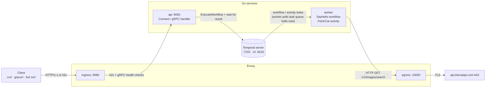

# hello-temporal

A "hello world" in Go where one service calls another API through a durable workflow:

> **client → Envoy → API service → Temporal → worker → Envoy → [TheCatAPI](https://docs.thecatapi.com/)**

You call `SayHello("Rich")`. The API starts a Temporal workflow. A worker runs an
activity that fetches a random cat from TheCatAPI. You get back a greeting plus a cat picture.

| Technology | Role in this project |
|---|---|
| **Buf** | Owns the API contract (`proto/`): linting, formatting, breaking-change checks, dependency management (protovalidate) and Go code generation. |
| **Connect-go** | Serves the contract as Connect (HTTP/JSON), gRPC and gRPC-Web from a single Go handler. |
| **protovalidate** | Declarative request validation in the `.proto` file, enforced by a server interceptor. |
| **Temporal** | Runs the work durably: timeouts, retries with backoff and a full execution history. It survives worker crashes. |
| **Envoy** | **Ingress** for clients (routing, access logs, active gRPC health checks) and **egress** to TheCatAPI (TLS, DNS, timeouts, fast retries). |

## Architecture



Request lifecycle:

1. A client calls `hello.v1.HelloService/SayHello` on **Envoy ingress** (`:9080`). Connect, gRPC and gRPC-Web all work.
2. Envoy forwards the call to the **API** over HTTP/2 cleartext. The protovalidate interceptor rejects bad input such as an empty name with `InvalidArgument` before any work starts.
3. The API calls `ExecuteWorkflow` on the **Temporal server** with a unique workflow ID, then blocks on the result.
4. The **worker** polls the `hello-cats` task queue. It runs the `SayHello` workflow, which schedules the `FetchCat` activity.
5. The activity calls TheCatAPI through **Envoy egress** (`:10000`). Envoy handles TLS, DNS and quick local retries.
6. The activity result is recorded in Temporal's history. The workflow builds the greeting, and the API maps the result to a protobuf response.

See [docs/architecture.md](docs/architecture.md) for the sequence diagram, failure handling, and the design decisions.

## Project layout

```
proto/hello/v1/hello.proto      API contract (source of truth)
buf.yaml, buf.gen.yaml          Buf module, lint/breaking rules, codegen (plugins pinned via `go tool`)
gen/                            Generated Go code (do not edit; `make generate`)
cmd/api                         API binary: Connect server, health, reflection
cmd/worker                      Temporal worker binary
internal/apiserver              HelloService handler: starts the workflow, maps errors to Connect codes
internal/hello                  Temporal workflow + activities (+ retry policy)
internal/catapi                 Tiny HTTP client for TheCatAPI
internal/envconfig              Env-var config helpers
deploy/envoy/envoy.yaml         Envoy ingress + egress config
scripts/stack.sh                Starts/stops the local stack natively
test/integration                API + real Temporal dev server + worker + fake TheCatAPI
test/e2e                        Calls the running stack through Envoy to the real TheCatAPI
```

## Prerequisites

macOS with Homebrew. On other platforms, install the same tools with your package manager.

```sh
brew install go temporal bufbuild/buf/buf envoy grpcurl
```

Docker is not needed. Every component runs as a local process.

## Run it

```sh
make up        # temporal dev server, worker, api, then envoy; waits until each is ready
make status    # process status
make logs      # tail all logs (.run/*.log)
make down      # stop everything
```

| Endpoint | URL |
|---|---|
| Envoy ingress (use this) | `http://127.0.0.1:9080` |
| Envoy admin (stats, clusters, config) | `http://127.0.0.1:9901` |
| Envoy egress to TheCatAPI | `http://127.0.0.1:10000` |
| API, direct and bypassing Envoy | `http://127.0.0.1:8081` |
| Temporal frontend and Web UI | `127.0.0.1:7233` and `http://127.0.0.1:8233` |

### Call it from the CLI

```sh
# Connect protocol: plain HTTP/1.1 + JSON
curl -s -X POST http://127.0.0.1:9080/hello.v1.HelloService/SayHello \
  -H 'Content-Type: application/json' -d '{"name":"Rich"}' | jq

# gRPC, using server reflection
grpcurl -plaintext -d '{"name":"Rich"}' 127.0.0.1:9080 hello.v1.HelloService/SayHello

# gRPC, using the local Buf schema (no reflection needed)
buf curl --protocol grpc --http2-prior-knowledge --schema . \
  --data '{"name":"Rich"}' http://127.0.0.1:9080/hello.v1.HelloService/SayHello

# Validation error: InvalidArgument with buf.validate.Violations details
grpcurl -plaintext -d '{"name":""}' 127.0.0.1:9080 hello.v1.HelloService/SayHello
```

Example response:

```json
{
  "greeting": "Hello, Rich! Here is a cat for you.",
  "cat": { "id": "cib", "url": "https://s3.us-west-2.amazonaws.com/cdn2.thecatapi.com/images/cib.jpg", "width": 500, "height": 331 },
  "workflowId": "say-hello-c566cceb-cb0a-4a14-9fac-8a5281f2a145",
  "runId": "01a11bd9-9b7b-73d0-8c70-fadc5d3c92e1"
}
```

### Inspect what happened

```sh
temporal workflow list                      # every SayHello execution
temporal workflow show -w <workflowId>      # full event history, including the FetchCat activity
curl -s 'http://127.0.0.1:9901/stats?filter=^cluster\.(api|thecatapi)\.upstream_rq_total$'
open http://127.0.0.1:8233                  # Temporal Web UI
```

### See durability in action

Stop the worker, send a request, then start the worker again:

```sh
kill "$(cat .run/worker.pid)"
curl -s -X POST http://127.0.0.1:9080/hello.v1.HelloService/SayHello \
  -H 'Content-Type: application/json' -d '{"name":"Durable"}' &   # hangs: workflow is Running
temporal workflow list --limit 1                                  # Status: Running
make up                                                           # restarts only the worker
```

The pending request completes as soon as the worker is back. Temporal kept the workflow
and its scheduled activity while no worker was available.

## Configuration

| Variable | Used by | Default |
|---|---|---|
| `TEMPORAL_ADDRESS` | api, worker | `127.0.0.1:7233` |
| `TEMPORAL_NAMESPACE` | api, worker | `default` |
| `API_ADDR` | api | `127.0.0.1:8081` |
| `WORKFLOW_TIMEOUT` | api | `30s` |
| `CAT_API_BASE_URL` | worker | `http://127.0.0.1:10000` (Envoy egress) |
| `CAT_API_KEY` | worker | empty. TheCatAPI works without a key at a lower rate limit. |

## Development

```sh
make generate          # buf dep update + buf generate
make lint              # buf lint, buf format, go vet, gofmt, envoy --mode validate
make test              # unit tests (race detector on)
make test-integration  # starts a real Temporal dev server in-process
make test-e2e          # needs `make up`; goes through Envoy to the real TheCatAPI
make breaking          # buf breaking against the main branch (needs a git repo)
```

### Test strategy

| Layer | What is real | What is faked | Location |
|---|---|---|---|
| Unit: HTTP client | `catapi.Client` | TheCatAPI (`httptest`) | `internal/catapi` |
| Unit: workflow | Workflow logic, retry policy | Activities, via Temporal's `TestWorkflowEnvironment` with time skipping | `internal/hello` |
| Unit: activity | Error classification | `CatFetcher` | `internal/hello` |
| Unit: API | Connect handler, protovalidate, health | Temporal client (`go.temporal.io/sdk/mocks`) | `internal/apiserver` |
| Integration | API over gRPC/TLS, Temporal server, worker, retries | TheCatAPI (`httptest`) | `test/integration` |
| End to end | Everything, including Envoy and TheCatAPI | Nothing | `test/e2e` |

Integration tests give each test its own task queue, so they run in parallel against one dev server.
