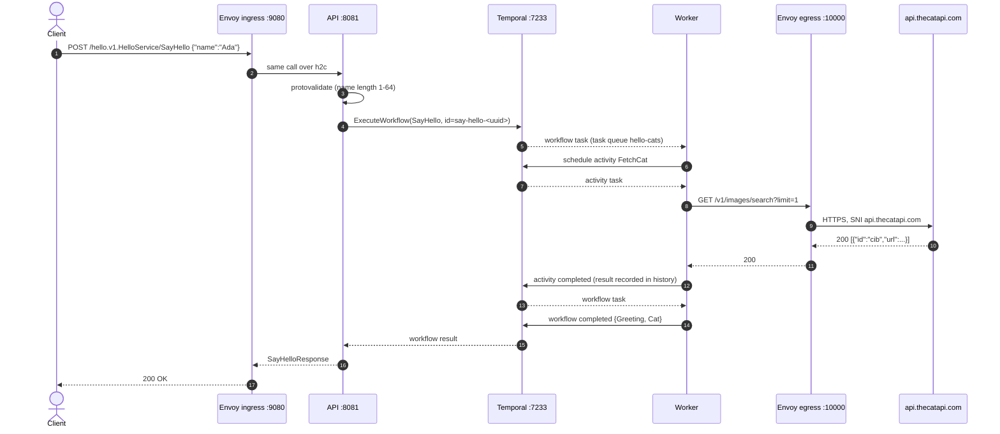

# Architecture

This document explains how the components interact, how failures are handled, and why the
project is built this way. For setup and usage, see the [README](../README.md).

## Components

| Component | Process | Responsibility |
|---|---|---|
| Envoy ingress | `envoy`, listener `:9080` | Single entry point for clients. Accepts HTTP/1.1 and h2c, forwards to the API over HTTP/2, writes access logs, and actively health-checks the API with the gRPC health protocol. |
| API | `cmd/api`, `:8081` | Implements `hello.v1.HelloService`. Validates input, starts the workflow, waits for the result and maps it to protobuf. It holds no business logic and no state. |
| Temporal server | `temporal server start-dev`, `:7233` | Persists workflow state and history. Dispatches workflow and activity tasks through the `hello-cats` task queue. Enforces timeouts and retries. |
| Worker | `cmd/worker` | Polls `hello-cats` and executes the `SayHello` workflow and the `FetchCat` activity. |
| Envoy egress | `envoy`, listener `:10000` | Outbound gateway to `api.thecatapi.com`. Owns TLS origination with certificate and SAN verification, DNS, the per-request timeout, and fast connection-level retries. |
| TheCatAPI | external | Returns random cat images. |

## Request sequence

## Where code runs

- **Workflow code** in `internal/hello/workflow.go` only orchestrates. It must be deterministic because Temporal replays it from history to rebuild state after a worker restart. It does no I/O, uses no wall-clock time and no randomness.
- **Activity code** in `internal/hello/activities.go` does the I/O. Each attempt is recorded, timed out and retried independently.
- **The API** never calls TheCatAPI itself. It only talks to Temporal, so slow or failing upstreams cannot exhaust it beyond the workflow timeout.

## Failure handling

Each layer handles the failures it is best placed to handle.

| Failure | Handled by | Behaviour |
|---|---|---|
| Invalid request, such as an empty or long name | protovalidate interceptor | `InvalidArgument` with structured `buf.validate.Violations`. No workflow is started. |
| API process down or unhealthy | Envoy ingress | Active gRPC health checks mark the host unhealthy. Callers get a fast 503. |
| Connection reset or 502/503/504 from TheCatAPI | Envoy egress | Up to 2 immediate retries within the 5s route timeout. |
| Transient TheCatAPI failure: 5xx, 429, network | Temporal activity retry | `ActivityOptions`: 10s start-to-close timeout, exponential backoff from 1s to 10s, at most 5 attempts. |
| Permanent TheCatAPI failure: 400, 401, 403, 404 | Activity error classification | Returned as a non-retryable `CatAPIClientError`. The workflow fails at once instead of retrying. |
| Worker crash or deploy mid-request | Temporal | Workflow state lives in the server. Another or restarted worker resumes from history, and the waiting API call completes. |
| Workflow exceeds 30s | Temporal execution timeout | The API returns `DeadlineExceeded`. Envoy's route timeout of 35s is set a little higher so the API's error wins. |
| Temporal unreachable when starting | API | `Unavailable`. |

Envoy retries cover quick network blips in milliseconds. Temporal retries cover longer outages
durably and appear in the workflow history. Keep Envoy's retry budget small so the two layers
don't multiply each other.

## Design decisions

**Buf is the contract owner.** The `.proto` file is the source of truth. Buf lints it with the
`STANDARD` rules, enforces formatting, guards compatibility with `buf breaking` using `FILE`
rules, and pulls `protovalidate` from the Buf Schema Registry. Code generation runs plugins through
`go tool`, so plugin versions are pinned in `go.mod` and nobody needs protoc installed.

**Connect-go instead of grpc-go.** One handler serves gRPC, gRPC-Web and the Connect protocol.
Connect is plain HTTP and JSON, so `curl` works without special tooling, while `grpcurl` and gRPC
clients still work. It uses the standard `net/http` stack, which keeps tests simple with `httptest`.
The project uses connect-go v1 with `connectrpc.com/validate` v0.7.0, because the health and
reflection packages have not moved to connect-go v2 yet.

**Synchronous request over an asynchronous engine.** The API waits for the workflow result to
keep the hello-world contract simple. For long-running work, return the `workflow_id` straight
away and let clients poll a `GetGreeting` RPC, or use a Temporal Update or Query.

**Envoy at both edges.** Ingress gives one stable entry point plus observability and health
checking. Egress keeps TLS, DNS and network policy out of application code. The Go client only
knows a local plaintext URL. Swapping the upstream, adding mTLS or adding rate limits becomes a
config change rather than a code change.

**Workflow IDs are unique per request** (`say-hello-<uuid>`). For idempotent client retries, let
the client supply a request ID and use it as the workflow ID. Temporal then rejects duplicate starts.

**Activity dependencies are injected.** `Activities` depends on a `CatFetcher` interface. This
keeps unit tests free of HTTP and lets integration tests point the real client at a fake server.

## Ports

| Port | Owner |
|---|---|
| 9080 | Envoy ingress |
| 9901 | Envoy admin |
| 10000 | Envoy egress to TheCatAPI |
| 8081 | API |
| 7233 | Temporal frontend (gRPC) |
| 8233 | Temporal Web UI |

Envoy ingress uses 9080 rather than the conventional 8080 to avoid clashing with other local tools.

## Taking it further

- Run the components in Docker Compose or Kubernetes. Only addresses in `envoy.yaml` and the env vars change.
- Add OpenTelemetry. The Temporal SDK has an OTel interceptor, connect-go has `otelconnect`, and Envoy can emit traces, which together give one trace across all hops.
- Use the Temporal Go SDK's worker versioning before changing workflow code in a non-deterministic way.
- Put an API key for TheCatAPI in Envoy using `request_headers_to_add` with an SDS secret instead of the worker env.
